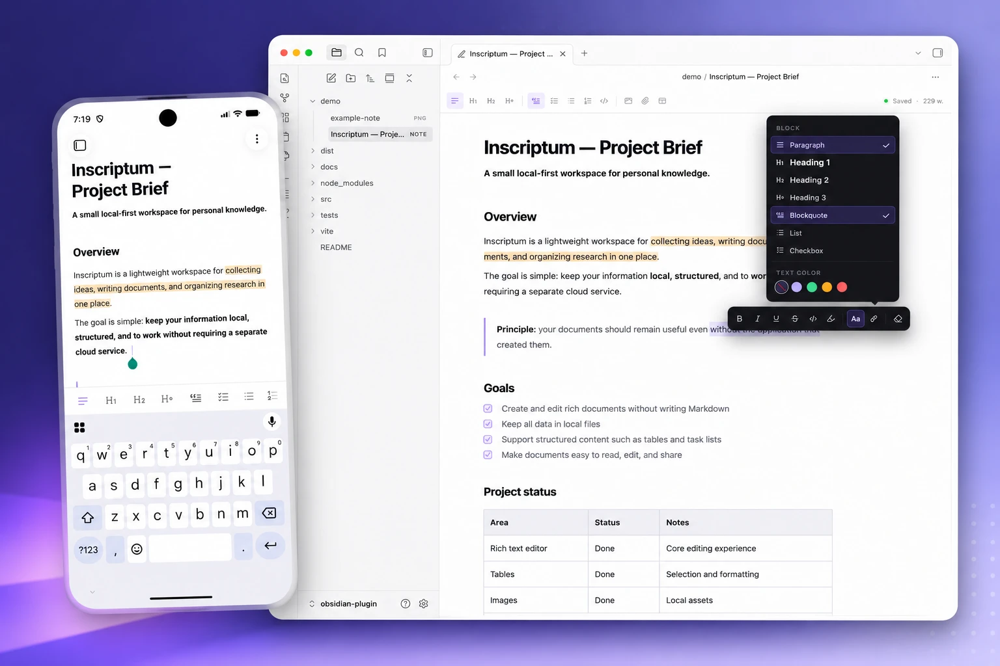
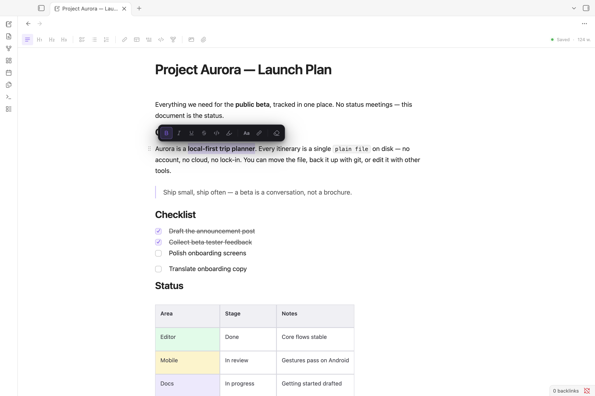
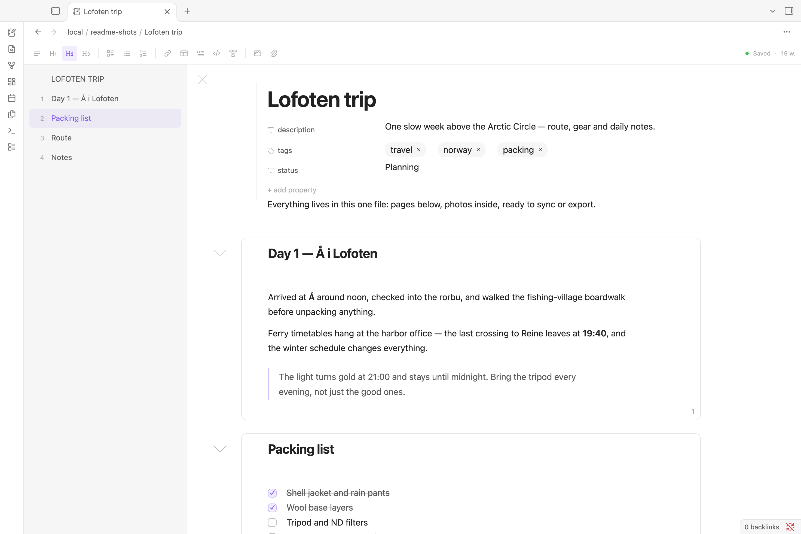
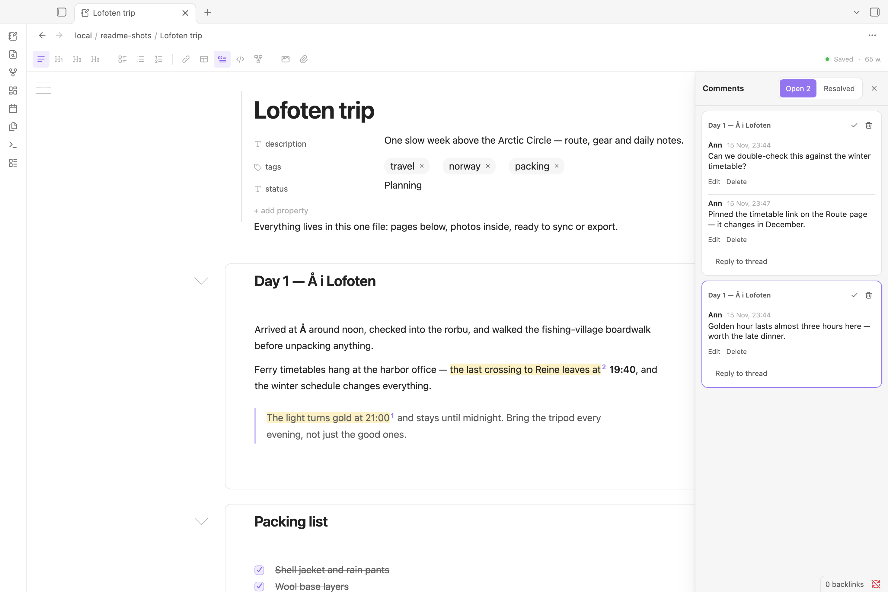
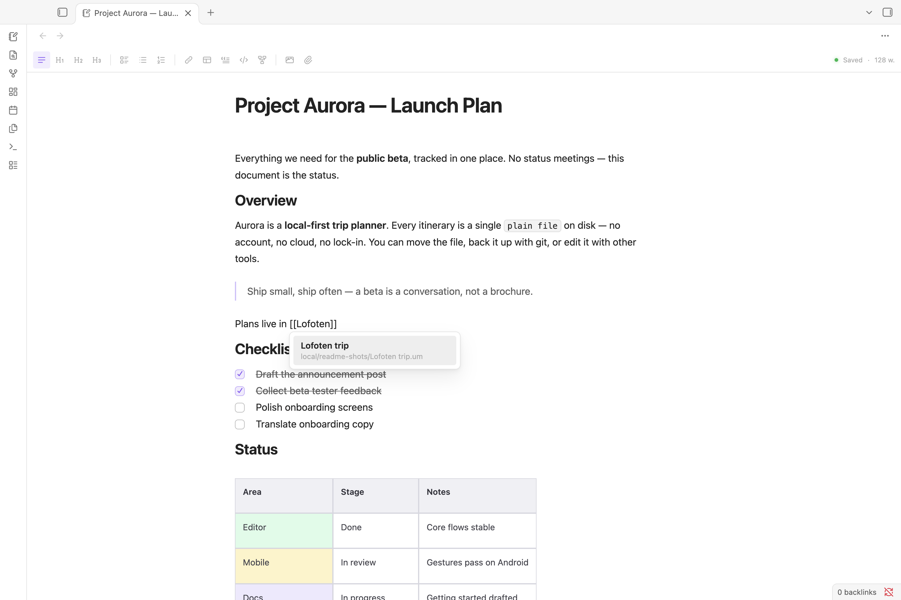
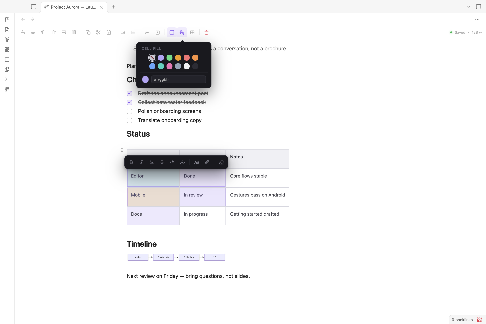
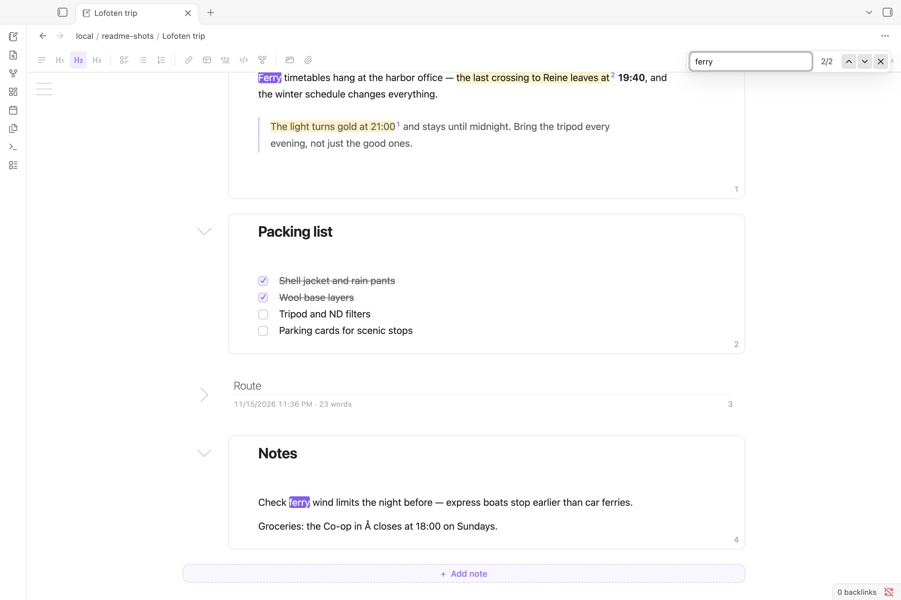

# Inscriptum — local-first rich text editor

**A comfortable editor for creating structured documents.**

Inscriptum lets you create and edit rich documents without having to write Markdown. Work in single notes or in notepads — one file that keeps many related pages together. Your documents stay local and under your control: no cloud, no account, no lock-in.

The Obsidian plugin brings Inscriptum to your Obsidian vault, allowing you to use the editor alongside your existing notes and workflow.

## Getting started

1. **Create a document.** Click the «New inscriptum» button in the file explorer (next to «New note»), right-click any folder for the same action, or run **New note** / **New notepad (.um)** from the command palette.
2. **Note or notepad?** A *note* (`.note`) is one document. A *notepad* (`.um`) is one file with many pages: a cover with properties, pages that fold away when you don't need them, and search across everything. Pick a note for a single document, a notepad for something structured — a journal, a guide, a project hub.
3. **Format as you go.** Select any text and the bubble menu appears — bold, headings, colors, links, comments. The toolbar above the note covers block types, tables, images, diagrams and attachments.
4. **Tune it in settings.** Open **Settings → Inscriptum** for the website export folder, the comment author name, experimental options and the diagnostic log.

## Features

* **WYSIWYG rich text editing** — headings, lists, quotes, highlights, text alignment (left, center, right) and code blocks, all without Markdown syntax

  

* **Bubble menu** for quick formatting right above your selection
* **Notepads** (`.um`): many pages in one file, with a cover page, a pages drawer and notebook-wide search

  

* **Cover properties**: add fields (description, tags, status, any name) to a notepad's cover, as text or lists
* **Headings and structured documents**, with foldable sections
* **Comments** (in notepads): select text, hit «Comment» and discuss it in a side panel — threads with replies, resolve/unresolve and an Open/Resolved filter

  

* **Internal links**: type «[[» and pick a file from the suggestion popup to link notes and notebooks together; links open on click and survive edits

  

* **Tables**: cell selection, cell fill colors, Word-style borders and images inside cells; duplicate rows and columns with one click

  

* **Spreadsheet exchange**: table cells copied from Inscriptum paste into Excel and Google Sheets as proper cells — and spreadsheet data pastes into your tables cell by cell
* **Search that reaches folded sections** — in a note or across a whole notepad; jumping to a match hidden in a folded section unfolds just that section, so the hit is on screen

  

* **Images**: resizing, text wrap layouts, and a gallery viewer with zoom and pan
* **Mermaid diagrams**: insert from the toolbar, edit the source with live syntax checks, render as theme-aware images
* **Todo lists and regular lists**, including nested subtasks — and an experimental «Dependent sub-tasks» mode where checking a parent checks its children (off by default, enable it in settings)
* **Links and automatic URL/email linking**
* **Attachments**: link vault files in place or copy them into the note
* **Code blocks with syntax highlighting**, with switchable highlighting themes
* **Undo and redo buttons** in the mobile toolbar — on a phone you can take an edit back with a tap
* **Guard rails**: changes made to the file you are editing outside the app — a git sync, another editor — are noticed and never silently overwritten
* **Follows your theme**: selection menus and task colors pick up your Obsidian accent color
* Works on desktop, phones and tablets

## Local-first

Inscriptum keeps your documents in your Obsidian vault.

There is no cloud service, no account, and no external storage required. Your documents and data remain on your device and under your control.

## Installation

### Via Community Plugins (recommended)

1. Open **Settings → Community plugins** in Obsidian.
2. Disable Restricted mode if it is on.
3. Click **Browse** and search for **Inscriptum**.
4. Install and enable it.

Alternatively, open the plugin page directly: [Inscriptum on Obsidian Plugins](https://community.obsidian.md/plugins/inscriptum).

### Via BRAT

If you want to try the latest development versions before they are released, install Inscriptum using [BRAT](https://obsidian.md/plugins?id=obsidian42-brat).

1. Install **BRAT** in Obsidian.

2. Open **BRAT → Add Beta Plugin**.

3. Add:

   `inscriptum/obsidian-plugin`

4. Install and enable **Inscriptum**.

### Manually

1. Download `main.js`, `manifest.json`, and `styles.css` from the [latest release](https://github.com/inscriptum/obsidian-plugin/releases).
2. Create the plugin directory:

   `.obsidian/plugins/inscriptum/`
3. Copy the downloaded files into it.
4. Reload Obsidian.
5. Enable **Inscriptum** under **Settings → Community plugins**.

### A note on Obsidian Sync

The plugin ships as a single `main.js` of about 6 MB (the Mermaid engine for
diagrams is bundled in). Obsidian Sync does not transfer files above 5 MB on
the Standard plan, so the plugin folder is **not synced** there: on your other
devices, install or update Inscriptum yourself (community list or a manual
copy). Everything else in the vault syncs as usual.

## Contributing

Development setup, tests and the release process are described in [CONTRIBUTING.md](CONTRIBUTING.md).

## License

MIT © 2026
